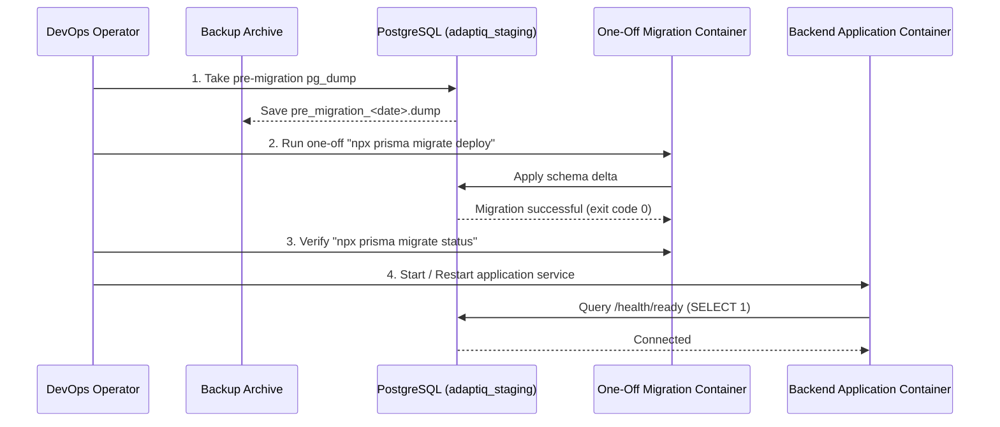

# Adapt-IQ — Step 3.5: Deployment Readiness & Recovery Plan

**Date:** October 21, 2026  
**Auditor Role:** Senior DevSecOps Engineer, PostgreSQL Recovery Specialist, Android Release Engineer, and Security Auditor  
**Context:** Continuation from Step 3.4C Pre-Deployment Audit and GitHub Synchronization  
**Repository:** `https://github.com/shaikbilal341-hub/Adapt-IQ.git`  
**Execution Mode:** Read-only planning, test isolation analysis, and disaster recovery design. Zero public deployment, zero database mutations, zero Git force-pushes.

---

## 1. Baseline State & Repository Sources of Truth

### 1.1 Git State & Commit Verification
- **Current Branch:** `main`
- **HEAD Commit:** `56951606ca531220c55fc46ada1deca6b390d31a` (`docs(audit): add Step 3 staging deployment plans and pre-deployment security audits`)
- **Remote Synchronization:** In sync with `origin/main` (`https://github.com/shaikbilal341-hub/Adapt-IQ.git`).
- **Working Tree State:** All changes from Step 2.2 and Step 3 implementation are committed. This planning report ([`docs/STEP_3_5_DEPLOYMENT_READINESS_AND_RECOVERY_PLAN.md`](file:///c:/Users/M.%20Devika%20Rani/StudioProjects/Adapt-IQ/docs/STEP_3_5_DEPLOYMENT_READINESS_AND_RECOVERY_PLAN.md)) remains an untracked local document (`??` in `git status`) and has not been committed, staged, or pushed.
- **Preservation Status:** All six Android Step 2.2 files (`admin/build.gradle.kts`, `app/build.gradle.kts`, `AdminAuthManager.kt`, `AdminApiService.kt`, `AdminLoginScreen.kt`, `AdaptIqApiService.kt`) and all backend security enhancements (`server.ts`, `cors.ts`, `rate-limiter.middleware.ts`, `auth.controller.ts`, `security.test.ts`, `docker-compose.prod.yml`) remain intact.

### 1.2 Authoritative Sources of Truth
1. **Configuration & Ingress:**
   - [`docker-compose.prod.yml`](file:///c:/Users/M.%20Devika%20Rani/StudioProjects/Adapt-IQ/docker-compose.prod.yml) defines network isolation, loopback binding (`127.0.0.1:4000:4000`), Compose service name `postgres` (container name `adaptiq_postgres_prod`), and mandatory environment variable declarations (`POSTGRES_USER`, `POSTGRES_PASSWORD`, `JWT_SECRET`).
   - [`backend/src/server.ts`](file:///c:/Users/M.%20Devika%20Rani/StudioProjects/Adapt-IQ/backend/src/server.ts) defines proxy trust (`app.set('trust proxy', 'loopback')`), security middleware mounting, and liveness/readiness probes.
   - [`backend/src/config/cors.ts`](file:///c:/Users/M.%20Devika%20Rani/StudioProjects/Adapt-IQ/backend/src/config/cors.ts) defines browser origin filtering and native mobile client bypass (missing `Origin` header).
2. **Database Schema & Migrations:**
   - [`backend/prisma/schema.prisma`](file:///c:/Users/M.%20Devika%20Rani/StudioProjects/Adapt-IQ/backend/prisma/schema.prisma) defines model definitions and relational constraints.
   - [`backend/prisma/migrations/0_init/migration.sql`](file:///c:/Users/M.%20Devika%20Rani/StudioProjects/Adapt-IQ/backend/prisma/migrations/0_init/migration.sql) represents the authoritative baseline migration for all seven application and research tables (`admin_users`, `participants`, `sessions`, `action_events`, `sensor_samples`, `upload_batches`, `audit_logs`) and indexes.
3. **Authentication & Authorization:**
   - [`backend/src/middleware/auth.middleware.ts`](file:///c:/Users/M.%20Devika%20Rani/StudioProjects/Adapt-IQ/backend/src/middleware/auth.middleware.ts) defines `validateAndGetJwtSecret()`, `authenticateToken`, `requireRole`, and IDOR ownership check `verifySessionOwnership`.
   - [`backend/src/scripts/create-admin.ts`](file:///c:/Users/M.%20Devika%20Rani/StudioProjects/Adapt-IQ/backend/src/scripts/create-admin.ts) provides the authoritative CLI path for administrator account provisioning using salted `bcrypt` hashes (12 rounds).
4. **Android Client Configuration:**
   - [`app/build.gradle.kts`](file:///c:/Users/M.%20Devika%20Rani/StudioProjects/Adapt-IQ/app/build.gradle.kts) & [`admin/build.gradle.kts`](file:///c:/Users/M.%20Devika%20Rani/StudioProjects/Adapt-IQ/admin/build.gradle.kts) enforce fail-fast HTTPS production URL requirements and prohibit loopback/LAN addresses in release builds.

---

## 2. Historical Credential Exposure & Revocation Protocol

### 2.1 Git History Finding
- **Historical Analysis:** Early commits in the repository history (prior to Step 1 security hardening) contained default passwords, placeholder database connection strings, and default JWT secret strings in early development files.
- **Invariance Rule:** Simply deleting or modifying files in later commits does **not** erase credentials from Git commit objects or packfiles.
- **Data Protection Constraint:** To prevent breaking existing development branches, Git history has **not** been rewritten or force-pushed.

### 2.2 Mandatory Rotation & Revocation Protocol
An authorized repository/system administrator must execute the following procedures before any staging or production deployment:
1. **Production Database Credential Generation:**
   - The production PostgreSQL database **must not** reuse any username or password present in Git history or `.env.example`.
   - The administrator must generate a cryptographically random, high-entropy password outside the repository:
     ```bash
     export POSTGRES_PASSWORD=$(openssl rand -base64 32)
     export POSTGRES_USER=adaptiq_prod_user
     ```
2. **Production JWT Secret Generation:**
   - The production `JWT_SECRET` **must not** match any historical key or placeholder.
   - Generate a minimum 256-bit high-entropy secret:
     ```bash
     export JWT_SECRET=$(openssl rand -base64 48)
     ```
   - Changing `JWT_SECRET` at deployment immediately invalidates all historical tokens.
3. **Administrator Account Credential Revocation:**
   - Do not import default development admin accounts into staging or production.
   - Create the initial staging researcher account using the secure CLI tool with a fresh password:
     ```bash
     npm run admin:create
     ```
4. **Verification Status:**
   - **UNVERIFIED IN PRODUCTION.** Credential rotation cannot be marked "completed" until a staging host is provisioned and injected with fresh secrets outside Git. Do not infer safety merely because current files omit old secrets.

---

## 3. Database Recovery Plan & Disaster Recovery Design

### 3.1 Scope & Research Data Protection
The recovery plan must protect all seven application and research tables defined in the schema:
1. `participants` (pseudonymized subject records)
2. `sessions` (research test sessions, start/end times, metadata)
3. `action_events` (monotonic time-stamped user actions, millisecond precision)
4. `sensor_samples` (accelerometer, gyroscope, proximity sensor streams)
5. `upload_batches` (idempotency records for chunked uploads)
6. `admin_users` (researcher RBAC records)
7. `audit_logs` (researcher audit actions, security events, and client IP tracking)

### 3.2 Explicit Staging Database Naming
- In `docker-compose.prod.yml`, the environment variable `POSTGRES_DB` must be explicitly configured as:
  ```env
  POSTGRES_DB=adaptiq_staging
  ```
- **Safety Rule:** Operators must **never** default to `adaptiq_research` or point staging configurations to active research databases.

### 3.3 Safe Backup Procedure (`pg_dump`)

#### Execution Context & Path Behavior:
- **Where it executes:** The `pg_dump` binary runs **inside** the PostgreSQL container (`adaptiq_postgres_prod`), while the shell redirection executes on the **host VM**.
- **Compose Service vs. Container Name:**
  - `docker compose -f docker-compose.prod.yml exec -T postgres ...` targets the Compose **service name** `postgres` defined in `docker-compose.prod.yml`.
  - The resulting runtime container name is `adaptiq_postgres_prod`. When using Docker CLI directly, specify `adaptiq_postgres_prod`.
- **Path interpretation:** The `$BACKUP_FILE` path exists **strictly on the host filesystem**, NOT inside the container. The container volume mapping (`adaptiq_pgdata_prod:/var/lib/postgresql/data`) does not mount host backup directories.
- **PostgreSQL Role & Credentials:** Accommodates the configured `$POSTGRES_USER` directly from container environment variables. Never assume the role is named `postgres`.
- **Failure Detection & Partial File Prevention:**
  - Direct shell redirection (`> "$BACKUP_FILE"`) creates the target file on the host filesystem immediately. If `pg_dump` crashes, times out, or encounters a disk or authentication error mid-stream, a corrupted or truncated partial file remains on disk. If unhandled, operators or automated systems may mistake this incomplete file for a valid backup.
  - To prevent partial backups from being accepted, the procedure streams into an explicit temporary file (`$TEMP_BACKUP_FILE`), captures and verifies the exit status of `docker compose exec`, confirms the resulting file is non-empty (`-s`), and only then atomically renames it to `$BACKUP_FILE`. If an error occurs, the partial temporary file is immediately purged.
- **Prerequisites & Limitations:**
  - The destination backup directory on the host (e.g. `/opt/adaptiq/backups`) must already exist with write permissions before executing redirection.
  - Shell-variable expansion: Using `sh -c 'pg_dump -U "$POSTGRES_USER" ...'` ensures `$POSTGRES_USER` is expanded by the container environment rather than an unset host variable.

```bash
# Host VM execution (UNEXECUTED RUNBOOK)
set -eo pipefail

BACKUP_DIR="/opt/adaptiq/backups"
mkdir -p "$BACKUP_DIR"

TIMESTAMP=$(date +%Y%m%d_%H%M%S)
BACKUP_FILE="$BACKUP_DIR/adaptiq_staging_${TIMESTAMP}.dump"
TEMP_BACKUP_FILE="${BACKUP_FILE}.tmp"

# Safe trap to ensure temporary backup file is purged on failure or interruption
cleanup_temp_backup() {
  if [ -f "$TEMP_BACKUP_FILE" ]; then
    echo "Purging incomplete temporary backup file: $TEMP_BACKUP_FILE" >&2
    rm -f "$TEMP_BACKUP_FILE"
  fi
}
trap cleanup_temp_backup EXIT INT TERM

# 1. Stream custom-format binary dump to a temporary file
echo "Initiating pg_dump stream to temporary file: $TEMP_BACKUP_FILE"
docker compose -f docker-compose.prod.yml exec -T postgres \
  sh -c 'pg_dump -U "$POSTGRES_USER" -d "$POSTGRES_DB" -F c -b -v' > "$TEMP_BACKUP_FILE"
DUMP_EXIT=$?

# 2. Check exit code and purge partial file on failure
if [ $DUMP_EXIT -ne 0 ]; then
  echo "CRITICAL ERROR: pg_dump failed with exit code $DUMP_EXIT! Purging partial backup." >&2
  exit 1
fi

# 3. Verify file exists and is non-empty before accepting
if [ ! -s "$TEMP_BACKUP_FILE" ]; then
  echo "CRITICAL ERROR: Generated backup file is empty (0 bytes)! Purging file." >&2
  exit 1
fi

# 4. Atomically commit temporary file to final backup destination
mv "$TEMP_BACKUP_FILE" "$BACKUP_FILE"

# Disarm trap now that backup file has been safely committed to final path
trap - EXIT INT TERM

# 5. Apply restrictive permissions strictly to the finalized backup file
chmod 600 "$BACKUP_FILE"
echo "Backup successfully written and verified non-empty: $BACKUP_FILE"
```

### 3.4 Four-Stage Backup Integrity Verification Framework

To ensure that backups are verifiable without risking live database corruption or false confidence, recovery procedures must distinguish four distinct validation levels:

1. **Stage 1: Archive Listing & Header Readability (`pg_restore -l`):**
   - Validates that the archive format magic number and header can be parsed.
   - Lists the Table of Contents (TOC) entries (table definitions, constraints, indices, and table data blocks).
   - **Crucial limitation:** Does NOT decompress data pages, does NOT read data blocks, does NOT verify checksums of compressed pages, and does NOT prove that tables can be restored without errors.
2. **Stage 2: Structural & Checksum Validation Capabilities:**
   - In PostgreSQL tooling, custom-format (`-F c`) archives compress data blocks using zlib and store block headers. However, `pg_restore` does **not** provide an independent `--verify` or `--checksum` dry-run mode that decompresses and validates all data blocks without writing to a target database.
   - *Note on tooling:* PostgreSQL 16+ provides `pg_verifybackup`, but that utility applies exclusively to physical base backups generated with `pg_basebackup`, **not** logical archives created by `pg_dump`.
   - Therefore, structural block-level verification cannot be performed solely by reading the TOC; it requires actual decompression and restoration into an engine.
3. **Stage 3: Restoration into an Isolated Disposable PostgreSQL Instance:**
   - The only definitive method to prove that all compressed data blocks are uncorrupted, complete, and restorable is executing `pg_restore` against a temporary, completely isolated disposable database instance.
   - Any corruption in data blocks or truncated streams will cause `pg_restore` to fail with a non-zero exit code during decompression or catalog insertion.
4. **Stage 4: Application-Level & Schema Semantic Verification:**
   - Post-restoration verification must query the restored disposable database to confirm:
     - Record counts for all seven application tables.
     - Referential integrity across foreign keys (e.g. `sessions` -> `participants`, `action_events` -> `sessions`).
     - Monotonic sequence and timestamp integrity (`elapsed_ms` in `action_events` and `sensor_samples`).
     - Prisma schema alignment (`npx prisma migrate status` reports zero pending or failed migrations).

> [!IMPORTANT]
> **HIERARCHY OF PROOF & DEMONSTRATED RECOVERABILITY:**  
> - **Non-Empty File Check (`-s`):** Proves only that stdout emitted bytes and a non-zero file exists on disk. It does not check file format, internal block headers, or catalog consistency.  
> - **Archive Listing Check (`pg_restore -l`):** Proves only that the archive header and Table of Contents (TOC) metadata are readable. It does **not** read or decompress data blocks, does **not** verify page checksums, and does **not** prove database restorable status.  
> - **Demonstrated Recoverability:** **ONLY** a successful restoration into an isolated disposable PostgreSQL instance (Stage 3) combined with passing application-level semantic verification across all seven tables (Stage 4) establishes demonstrated database recoverability.

#### Read-Only Archive Inspection Command & Pipeline Safety (UNEXECUTED DOCUMENTATION):
```bash
# Host VM execution (read-only inspection of Table of Contents)
# Ensure shell pipeline failure detection: in Bash, set -o pipefail is required
# so that if pg_restore fails on a corrupted stream, the failure is not masked by grep!
set -o pipefail

# Check that TOC is readable and verify presence of all 7 expected application tables
docker compose -f docker-compose.prod.yml exec -T postgres \
  sh -c 'pg_restore -l' < "$BACKUP_FILE" | grep -E "TABLE DATA (public )?(admin_users|participants|sessions|action_events|sensor_samples|upload_batches|audit_logs)"
```

> [!IMPORTANT]
> **PIPELINE FAILURE DETECTION & LIMITATION WARNING:**  
> - A standard Unix pipe (`cmd1 | cmd2`) returns the exit code of `cmd2` (`grep`). If `pg_restore` aborts mid-stream or encounters an error after outputting some lines, `grep` may still exit with `0`, masking a critical backup failure!  
> - Operators must enable `set -o pipefail` or save the TOC output to a temporary file, verifying the exit code of `pg_restore -l` independently.  
> - Confirming TOC table entries proves only that `pg_dump` recorded the catalog metadata when the backup started. It does **not** prove data block integrity or successful restorable status.

### 3.5 Test Restoration on an Isolated Disposable PostgreSQL Instance

> [!CAUTION]
> **CRITICAL ARCHITECTURAL ISOLATION RULE:**  
> A recovery drill must **NEVER** be executed against the active staging or production database container cluster (`adaptiq_postgres_prod`).  
> Performing a restore into `adaptiq_recovery_disposable` on the same database cluster shares disk volumes, memory, WAL logs, and connection pools with the live database. A large restore risks disk exhaustion (causing PostgreSQL to crash or enter read-only mode for the entire cluster), heavy I/O thrashing, and human error in `DROP DATABASE` or `pg_restore` commands.  
> A `SELECT current_database()` check alone does **NOT** provide a complete safety guarantee against cluster-level resource exhaustion or connection confusion.

#### Verification Status:
**STATUS: NOT VERIFIED — DO NOT EXECUTE AGAINST THE ACTIVE DATABASE CLUSTER.**

#### Restore Permissions, Role Ownership, and Compatibility Analysis:
Before attempting any recovery drill in a disposable environment, consider these PostgreSQL object-level factors:
- **Object Ownership & Missing Roles:**
  - `pg_dump` custom format preserves object ownership (`ALTER TABLE ... OWNER TO <role>`). If the backup was generated by user `$POSTGRES_USER` (e.g. `adaptiq_prod_user`), the archive contains ownership assignment commands for that role.
  - If the disposable container is initialized with a different user (e.g. `drill_user`), `pg_restore` will emit errors: `ERROR: role "<role>" does not exist`.
  - In a disposable drill, passing `--no-owner` to `pg_restore` forces all restored objects to be owned by the connecting user (`drill_user`).
  - *Limitation of `--no-owner`:* While it allows data decompression and structural restoration to succeed, it does **not** validate the production ownership hierarchy. For true production disaster recovery, cluster-level roles must be provisioned (e.g. via `pg_dumpall --globals-only`) prior to database restoration.
- **Grants & Access Privileges:**
  - Backups preserve table-level and schema-level grants. If the archive references production roles that do not exist in the drill container, permission assignment statements fail.
  - In a disposable drill, passing `--no-privileges` (`-x`) suppresses grant/revoke commands.
  - *Limitation of `--no-privileges`:* Suppresses privilege errors, but does not validate production RBAC grants.
  - *Error Handling:* Do **not** silently suppress errors with `|| true` or ignore `pg_restore` exit codes. Any error outside of expected ownership/privilege warnings must be investigated.
- **Network Isolation & Default Bridge Limitations:**
  - A container started without an explicit network flag connects to Docker's default `bridge` network.
  - *Nuance & Limitations:* While attaching to the default bridge isolates the container from custom Compose networks (such as `adaptiq_internal`), it does **not** provide complete network isolation. Containers on Docker's default bridge can communicate with other default-bridge containers by IP address (unless daemon-level inter-container communication `icc: false` is enabled) and have outbound network egress to the host LAN and public Internet via NAT/masquerading.
  - *Maximum Isolation Mode (`--network none`):* To enforce true, provable network isolation during drills, the disposable container can be launched with `--network none`. In this mode, all external and inter-container IP networking is disabled (only local loopback exists). Local PostgreSQL operations inside `docker exec` (`psql`, `pg_restore`) function seamlessly because they communicate over the local Unix-domain socket (`/var/run/postgresql/.s.PGSQL.5432`), bypassing network interfaces entirely.
- **Extensions:**
  - Verified from `backend/prisma/migrations/0_init/migration.sql` and `schema.prisma`: Adapt-IQ currently uses zero PostgreSQL extensions (no `uuid-ossp`, `pgcrypto`, etc.). All UUIDs are generated at the application tier. Therefore, no extension creation privileges or superuser requirements exist in the current baseline.
- **PostgreSQL Version Compatibility:**
  - The repository specifies `postgres:15-alpine` in [`docker-compose.prod.yml`](file:///c:/Users/M.%20Devika%20Rani/StudioProjects/Adapt-IQ/docker-compose.prod.yml). The disposable drill container must strictly use `postgres:15-alpine`. Restoring across different major versions (e.g. 15 dump into 16 container, or vice versa) can introduce catalog incompatibilities.
- **Unverified Attributes:**
  - Any cluster-level parameters (`ALTER SYSTEM`, custom tablespaces, or uncommitted migration scripts) remain **UNVERIFIED** and must not be assumed.

#### Container Cleanup Architecture & Safe Disposal Lifecycle:
- **Targeted Disposal Only:** The recovery drill uses an explicitly named container (`adaptiq_recovery_drill_tmp`). The cleanup routine targets strictly this unique container name (`docker rm -f adaptiq_recovery_drill_tmp`).
- **Interaction Between `--rm` and Explicit Trap Cleanup:**
  - The `docker run --rm` flag directs the Docker daemon to automatically remove the container's writable layer and registration upon container process termination.
  - However, `--rm` only triggers *after* the container stops. If a drill script encounters an error, hangs, or is aborted via interrupt (`SIGINT` / `Ctrl+C`) while the container is actively running, `--rm` does **not** stop the container; the container would remain running indefinitely in the background.
  - To prevent orphaned test containers, an explicit POSIX shell trap (`trap cleanup EXIT INT TERM`) is armed at step 0. It executes `docker rm -f adaptiq_recovery_drill_tmp`, which forcefully stops and deletes the container on normal exit, unexpected error (`set -e`), or process interruption.
  - The explicit trap and `--rm` complement each other: the trap guarantees immediate termination on script abort, while `--rm` ensures no residual container metadata lingers if stopped directly by Docker.
- **Strict Prohibition of Broad Deletion:**
  - Operators and automation scripts must **NEVER** use broad, wildcard, or untargeted cleanup commands, including:
    - `docker system prune` (erases build caches, unrelated stopped containers, and untagged images).
    - Wildcard container removal: `docker rm -f $(docker ps -aq)` (destroys active staging or production services running on the same host).
    - Production Compose volume removal: `docker compose -f docker-compose.prod.yml down -v` (permanently deletes `adaptiq_pgdata_prod` and destroys all research data).
  - Cleanup must remain isolated to the disposable drill container alone.

#### Approved Protocol for Isolated Recovery Drills (UNEXECUTED DOCUMENTATION):
The following runbook describes how an authorized operator on an isolated test machine can conduct a recovery drill using an **independent, ephemeral disposable container** without touching the production or staging database:

```bash
# UNEXECUTED DOCUMENTATION — DO NOT RUN AGAINST PRODUCTION HOSTS
set -eo pipefail

# 0. AUTOMATED FAIL-SAFE CLEANUP TRAP:
# Guarantees cleanup on success, script error, or interruption.
# SAFETY RULE: Targets strictly the uniquely named disposable container.
# NEVER use wildcard deletion (docker rm -f $(docker ps -aq)) or docker system prune!
cleanup() {
  echo "Executing fail-safe cleanup: removing adaptiq_recovery_drill_tmp..."
  docker rm -f adaptiq_recovery_drill_tmp >/dev/null 2>&1 || true
}
trap cleanup EXIT INT TERM

# 1. Start a temporary, completely isolated disposable PostgreSQL container
# - Uses verified repository image: postgres:15-alpine
# - Uses --network none for provable network isolation (disables external/internal IP routing)
# - NO published host ports (-p is omitted to prevent host port conflicts and network exposure)
# - NO persistent volume (uses ephemeral container writable layer; --rm discards data on stop)
docker run --rm -d \
  --name adaptiq_recovery_drill_tmp \
  --network none \
  -e POSTGRES_USER=drill_user \
  -e POSTGRES_PASSWORD=drill_temporary_password \
  -e POSTGRES_DB=adaptiq_recovery_disposable \
  postgres:15-alpine

# 2. Bounded Readiness Check: Wait for PostgreSQL readiness signal (timeout: 30s)
# Replaces fixed-delay "sleep 5" with a deterministic, fail-closed polling loop
READY=0
for i in $(seq 1 30); do
  if docker exec adaptiq_recovery_drill_tmp pg_isready -U drill_user -d adaptiq_recovery_disposable >/dev/null 2>&1; then
    READY=1
    echo "Disposable PostgreSQL instance is ready after ${i}s."
    break
  fi
  sleep 1
done

if [ "$READY" -ne 1 ]; then
  echo "CRITICAL ERROR: Disposable PostgreSQL failed to become ready within 30 seconds." >&2
  docker logs adaptiq_recovery_drill_tmp
  exit 1
fi

# 3. INDEPENDENT CONTAINER ISOLATION VERIFICATION:
# Fail closed if any Docker inspection command fails or returns unexpected attributes.
# A. Prove that the target container is distinct from the active database cluster
DRILL_CID=$(docker inspect --format '{{.Id}}' adaptiq_recovery_drill_tmp) || {
  echo "CRITICAL ERROR: Failed to inspect container ID for adaptiq_recovery_drill_tmp!" >&2
  exit 1
}
if [ -z "$DRILL_CID" ]; then
  echo "CRITICAL ERROR: Container ID for adaptiq_recovery_drill_tmp is empty!" >&2
  exit 1
fi

PROD_CID=$(docker inspect --format '{{.Id}}' adaptiq_postgres_prod 2>/dev/null || echo "not_running")
if [ "$DRILL_CID" = "$PROD_CID" ]; then
  echo "CRITICAL ERROR: Drill container ID matches production database container ID!" >&2
  exit 1
fi

# B. Verify zero published host ports
HOST_PORTS=$(docker inspect --format '{{range $p, $conf := .NetworkSettings.Ports}}{{if $conf}}{{$p}} -> {{(index $conf 0).HostPort}} {{end}}{{end}}' adaptiq_recovery_drill_tmp) || {
  echo "CRITICAL ERROR: Failed to inspect network ports for adaptiq_recovery_drill_tmp!" >&2
  exit 1
}
if [ -n "$HOST_PORTS" ]; then
  echo "CRITICAL ERROR: Drill container has published host ports: $HOST_PORTS" >&2
  exit 1
fi

# C. Verify no mounts of persistent production volumes or host database directories
MOUNTS=$(docker inspect --format '{{range .Mounts}}{{.Name}} {{.Source}} -> {{.Destination}}{{println}}{{end}}' adaptiq_recovery_drill_tmp) || {
  echo "CRITICAL ERROR: Failed to inspect volume mounts for adaptiq_recovery_drill_tmp!" >&2
  exit 1
}
if echo "$MOUNTS" | grep -E "adaptiq_pgdata_prod|/var/lib/postgresql/data"; then
  echo "CRITICAL ERROR: Drill container mounted production volume or persistent database path!" >&2
  exit 1
fi

# D. Verify zero attachment to production Compose network adaptiq_internal
ATTACHED_NETS=$(docker inspect --format '{{json .NetworkSettings.Networks}}' adaptiq_recovery_drill_tmp) || {
  echo "CRITICAL ERROR: Failed to inspect networks for adaptiq_recovery_drill_tmp!" >&2
  exit 1
}
if echo "$ATTACHED_NETS" | grep -q "adaptiq_internal"; then
  echo "CRITICAL ERROR: Drill container is attached to production network adaptiq_internal!" >&2
  exit 1
fi

# 4. Copy the host backup file into the isolated container filesystem (enables random-access seek)
docker cp "$BACKUP_FILE" adaptiq_recovery_drill_tmp:/tmp/backup.dump

# 5. DATABASE TARGET VERIFICATION & ASSERTION:
# Over Unix-domain sockets (default inside docker exec), inet_server_addr() returns NULL!
# String concatenation with NULL in standard SQL (text || NULL) returns NULL.
# We query individual columns or use COALESCE to display socket connection type.
TARGET_INFO=$(docker exec adaptiq_recovery_drill_tmp \
  psql -U drill_user -d adaptiq_recovery_disposable -t -A -c \
  "SELECT current_database() || '|' || current_user || '|' || COALESCE(inet_server_addr()::text, 'unix_socket');") || {
  echo "CRITICAL ERROR: Failed to query target database identity via psql!" >&2
  exit 1
}

echo "Connected target: $TARGET_INFO"

# Mandatory Target Assertion: Abort immediately if connected database or user does not match
if [ "$TARGET_INFO" != "adaptiq_recovery_disposable|drill_user|unix_socket" ]; then
  echo "CRITICAL ERROR: Connected target mismatch! Expected 'adaptiq_recovery_disposable|drill_user|unix_socket', got: '$TARGET_INFO'" >&2
  exit 1
fi
# NOTE: Target identity verification confirms the session connected to the expected database name,
# but database-name checking alone is NOT a proof of container isolation.
# The container ID, volume mount, port, and network inspection checks in Step 3 are mandatory independent isolation gates.

# 6. Restore archive into the verified disposable container ONLY
# Using --no-owner and --no-privileges to accommodate disposable drill_user role
docker exec adaptiq_recovery_drill_tmp \
  pg_restore -U drill_user -d adaptiq_recovery_disposable --no-owner --no-privileges -v /tmp/backup.dump
RESTORE_EXIT=$?

if [ $RESTORE_EXIT -ne 0 ]; then
  echo "CRITICAL ERROR: pg_restore failed with exit code $RESTORE_EXIT!" >&2
  exit 1
fi

# 7. Application-Level Semantic Verification with Explicit PASS/FAIL Outcomes:
# A. Record counts across all 7 application tables in the repository schema
TABLE_COUNTS=$(docker exec adaptiq_recovery_drill_tmp \
  psql -U drill_user -d adaptiq_recovery_disposable -t -A -c "
    SELECT 'participants' || '|' || count(*) FROM participants
    UNION ALL SELECT 'sessions' || '|' || count(*) FROM sessions
    UNION ALL SELECT 'action_events' || '|' || count(*) FROM action_events
    UNION ALL SELECT 'sensor_samples' || '|' || count(*) FROM sensor_samples
    UNION ALL SELECT 'upload_batches' || '|' || count(*) FROM upload_batches
    UNION ALL SELECT 'admin_users' || '|' || count(*) FROM admin_users
    UNION ALL SELECT 'audit_logs' || '|' || count(*) FROM audit_logs;
  ")
PSQL_COUNT_EXIT=$?

if [ $PSQL_COUNT_EXIT -ne 0 ] || [ -z "$TABLE_COUNTS" ]; then
  echo "CRITICAL ERROR: Failed to query table counts from restored database or received empty output (exit: $PSQL_COUNT_EXIT)!" >&2
  exit 1
fi

echo "Table Record Counts:"
echo "$TABLE_COUNTS"

# Verify all seven tables are accounted for in the output
REQUIRED_TABLES=("participants" "sessions" "action_events" "sensor_samples" "upload_batches" "admin_users" "audit_logs")
for tbl in "${REQUIRED_TABLES[@]}"; do
  if ! echo "$TABLE_COUNTS" | grep -E -q "^${tbl}\|[0-9]+$"; then
    echo "CRITICAL ERROR: Missing, incomplete, or malformed record count for table '$tbl'!" >&2
    exit 1
  fi
done
echo "All 7 application tables verified present with valid counts."

# B. Referential Integrity & Monotonic Timestamp Verification:
# Uses NOT EXISTS rather than NOT IN to prevent SQL NULL three-valued logic bugs
# (where a single NULL in a subquery causes NOT IN to silently evaluate to false/unknown).
INTEGRITY_CHECK=$(docker exec adaptiq_recovery_drill_tmp \
  psql -U drill_user -d adaptiq_recovery_disposable -t -A -c "
    WITH check_results AS (
      SELECT 'orphaned_sessions' AS check_name, count(*) AS violations
      FROM sessions s
      WHERE s.participant_id IS NOT NULL
        AND NOT EXISTS (SELECT 1 FROM participants p WHERE p.id = s.participant_id)
      UNION ALL
      SELECT 'orphaned_action_events', count(*)
      FROM action_events e
      WHERE NOT EXISTS (SELECT 1 FROM sessions s WHERE s.id = e.session_id)
      UNION ALL
      SELECT 'orphaned_sensor_samples', count(*)
      FROM sensor_samples ss
      WHERE NOT EXISTS (SELECT 1 FROM sessions s WHERE s.id = ss.session_id)
      UNION ALL
      SELECT 'negative_elapsed_ms_events', count(*)
      FROM action_events WHERE elapsed_ms < 0
      UNION ALL
      SELECT 'negative_elapsed_ms_samples', count(*)
      FROM sensor_samples WHERE elapsed_ms < 0
    )
    SELECT check_name || '|' || violations || '|' || CASE WHEN violations = 0 THEN 'PASS' ELSE 'FAIL' END
    FROM check_results;
  ")
PSQL_INTEGRITY_EXIT=$?

# 1. Fail closed on non-zero psql exit code or empty output
if [ $PSQL_INTEGRITY_EXIT -ne 0 ] || [ -z "$INTEGRITY_CHECK" ]; then
  echo "CRITICAL ERROR: Integrity query failed or returned empty output (exit: $PSQL_INTEGRITY_EXIT)!" >&2
  exit 1
fi

echo "Semantic Verification Results:"
echo "$INTEGRITY_CHECK"

# 2. Require EVERY expected check to be present and explicitly evaluate to PASS with 0 violations.
# Do NOT treat missing checks or empty output as success.
REQUIRED_CHECKS=(
  "orphaned_sessions"
  "orphaned_action_events"
  "orphaned_sensor_samples"
  "negative_elapsed_ms_events"
  "negative_elapsed_ms_samples"
)

for check in "${REQUIRED_CHECKS[@]}"; do
  # Each expected check must match the exact pattern: <check_name>|0|PASS
  if ! echo "$INTEGRITY_CHECK" | grep -E -q "^${check}\|0\|PASS$"; then
    echo "CRITICAL ERROR: Semantic verification check '${check}' FAILED, was missing, or reported non-zero violations!" >&2
    exit 1
  fi
done

# 3. Fail closed if any 'FAIL' or non-zero violation appears anywhere in the output
if echo "$INTEGRITY_CHECK" | grep -q "FAIL"; then
  echo "CRITICAL ERROR: One or more semantic integrity checks reported FAIL!" >&2
  exit 1
fi

echo "All 5 semantic integrity checks verified present and PASSED with zero violations."

# 8. Explicit Cleanup: The trap set in Step 0 ensures container is destroyed on any exit,
# and we explicitly invoke it here on the normal completion path:
cleanup
```

---

## 4. Migration and Container Startup Safety

### 4.1 Current Container Startup Analysis (`backend/Dockerfile:49`)
```dockerfile
CMD ["sh", "-c", "npx prisma migrate deploy && node dist/server.js"]
```

### 4.2 Risks of Startup Migrations
1. **Unrecoverable Crash Loops:** If a migration fails mid-flight (e.g. database connection timeout or syntax issue), Prisma records the migration as `failed` in `_prisma_migrations`. Once in a failed state, `prisma migrate deploy` aborts on subsequent runs. With `restart: always`, the container enters an infinite crash loop.
2. **Lack of Automatic Rollback:** Prisma does **not** roll back failed migrations automatically. The database remains in a partial state until manually fixed.
3. **Lock Contention in Multi-Replica Topologies:** If multiple backend containers start concurrently, simultaneous migration execution causes lock contention on the migrations table.

### 4.3 Controlled Staging Migration Procedure
For staging and production environments, migrations should follow a controlled, decoupled execution procedure:



#### Step-by-Step Operator Runbook:
1. **Pre-Migration Snapshot:** Take a compressed `pg_dump` of `adaptiq_staging` before triggering any migration command.
2. **One-Off Migration Execution:**
   ```bash
   docker compose -f docker-compose.prod.yml run --rm backend npx prisma migrate deploy
   ```
3. **Migration Verification:**
   ```bash
   docker compose -f docker-compose.prod.yml run --rm backend npx prisma migrate status
   ```

#### 4.4 Migration Failure Recovery & Rollback Realities
> [!WARNING]
> **CRITICAL PRISMA MIGRATION ROLLBACK WARNING:**  
> - `npx prisma migrate resolve --rolled-back <migration_name>` does **NOT** roll back or execute any SQL DDL to undo schema changes! It ONLY updates the metadata row in the `_prisma_migrations` table (setting `rolled_back_at = now()`).
> - If any DDL statements in the failed migration succeeded before the failure occurred, those tables, columns, indexes, or constraints **still exist in the PostgreSQL database**.
> - Simply marking the migration as rolled-back without manually repairing or reverting the actual database schema creates immediate schema desynchronization from Prisma's migration history, causing subsequent migrations or application queries to fail.
> - A successful TypeScript compilation (`npm run build`) only proves type compatibility with the generated client; it does **not** prove runtime database schema compatibility.
> - Restoring a backup permanently discards and overwrites any participant data or telemetry written after the backup was taken!
> - **MANDATORY INVESTIGATION GATE:** No state-changing command (`prisma migrate resolve`, `DROP TABLE`, `ALTER TABLE`, or backup restore) may be executed until the actual database failure state is inspected, reproduced on an isolated disposable container, and verified against a tested corrective procedure.

#### Approved Failure Recovery Protocol (UNEXECUTED RUNBOOK):
1. **Halt Application Traffic Immediately:** Stop the backend service to prevent data corruption, inconsistent writes, or connection retries:
   ```bash
   docker compose -f docker-compose.prod.yml stop backend
   ```
2. **Investigate Database State & Catalog Evidence:**
   - Inspect `_prisma_migrations` to determine the failed migration name, start time, and error record:
     ```bash
     docker compose -f docker-compose.prod.yml exec -T postgres \
       sh -c 'psql -U "$POSTGRES_USER" -d "$POSTGRES_DB" -c "SELECT migration_name, started_at, finished_at, rolled_back_at, logs FROM _prisma_migrations ORDER BY started_at DESC LIMIT 5;"'
     ```
   - Inspect the PostgreSQL catalog (`information_schema.tables`, `information_schema.columns`) to determine which DDL objects were actually committed before the error occurred.
3. **Isolate and Replicate in Disposable Environment:**
   - Restore the pre-migration snapshot into an **independent disposable container** (`adaptiq_recovery_drill_tmp`, see Section 3.5).
   - Replicate the migration failure in that isolated environment to determine the precise statement that triggered the failure.
4. **Develop and Review Corrective Procedure:**
   - Write an explicit compensating SQL script or forward migration to repair the schema.
   - Test the corrective script on the disposable container until `npx prisma migrate status` reports a clean, synchronized schema.
   - Obtain peer and DevSecOps review of the tested corrective procedure before touching staging.
5. **Apply Corrective DDL & Reconcile Prisma Metadata:**
   - Once the database schema is manually repaired and verified on staging, mark the failed migration as resolved:
     ```bash
     docker compose -f docker-compose.prod.yml run --rm backend \
       npx prisma migrate resolve --rolled-back <failed_migration_name>
     ```
6. **No Routine Live Overwrites:** Never restore into active staging or production using `--clean` during routine maintenance or drills. Live database restoration is an emergency disaster recovery action requiring explicit project owner authorization, a confirmed pre-restore dump, and verified database target naming.

---

## 5. Security Acceptance Checklist

| Control / Property | Implementation Source | Audit Evidence | Acceptance Status |
| :--- | :--- | :--- | :---: |
| **JWT Secret Strength & Startup Fail-Fast** | [`auth.middleware.ts:14-33`](file:///c:/Users/M.%20Devika%20Rani/StudioProjects/Adapt-IQ/backend/src/middleware/auth.middleware.ts#L14-L33) | 5 automated tests verify missing, whitespace, placeholder, and <32 char secrets trigger immediate process exit. | **VERIFIED** |
| **Admin Password Hashing** | [`create-admin.ts`](file:///c:/Users/M.%20Devika%20Rani/StudioProjects/Adapt-IQ/backend/src/scripts/create-admin.ts)<br>[`server.ts:37`](file:///c:/Users/M.%20Devika%20Rani/StudioProjects/Adapt-IQ/backend/src/server.ts#L37) | Password hashing enforces `bcrypt` with 12 salt rounds. Tested in `security.test.ts:57-69`. | **VERIFIED** |
| **Admin Login Rate Limiting** | [`rate-limiter.middleware.ts:3-12`](file:///c:/Users/M.%20Devika%20Rani/StudioProjects/Adapt-IQ/backend/src/middleware/rate-limiter.middleware.ts#L3-L12) | Configured at 5 attempts / 15 min on `POST /admin/login`. Participant uploads remain unthrottled. Memory store limited to single-instance staging. | **VERIFIED** |
| **CORS Policy & Native Mobile Compatibility** | [`cors.ts:10-28`](file:///c:/Users/M.%20Devika%20Rani/StudioProjects/Adapt-IQ/backend/src/config/cors.ts#L10-L28) | Missing `Origin` allowed for native Android apps; browser origins validated against `ALLOWED_ORIGINS`. Endpoints independently require JWT. | **VERIFIED** |
| **RBAC & IDOR Ownership Checks** | [`auth.middleware.ts:68-95`](file:///c:/Users/M.%20Devika%20Rani/StudioProjects/Adapt-IQ/backend/src/middleware/auth.middleware.ts#L68-L95) | `requireRole('RESEARCHER')` guards admin exports; `verifySessionOwnership` prevents participants from accessing other sessions. | **VERIFIED** |
| **Database Network Isolation** | [`docker-compose.prod.yml:12-13`](file:///c:/Users/M.%20Devika%20Rani/StudioProjects/Adapt-IQ/docker-compose.prod.yml#L12-L13) | PostgreSQL port 5432 has no host publishing. Backend bound strictly to `127.0.0.1:4000:4000`. Isolated on `adaptiq_internal` bridge network. | **VERIFIED** |
| **Liveness vs. Readiness Separation** | [`server.ts:53-66`](file:///c:/Users/M.%20Devika%20Rani/StudioProjects/Adapt-IQ/backend/src/server.ts#L53-L66) | `/health` is in-memory liveness. `/health/ready` executes `await prisma.$queryRaw\`SELECT 1\`` and returns 503 on error without disclosing internals. | **VERIFIED** |
| **Reverse-Proxy Trust (`trust proxy`)** | [`server.ts:18`](file:///c:/Users/M.%20Devika%20Rani/StudioProjects/Adapt-IQ/backend/src/server.ts#L18) | Configured with `app.set('trust proxy', 'loopback')` to trust Caddy on host `127.0.0.1`. Rejects external header spoofing. | **VERIFIED** |
| **Edge TLS, HTTPS & HSTS** | External Caddy configuration | Helmet suppresses HSTS over HTTP; host Caddy reverse proxy must terminate TLS and inject HSTS header at the edge. | **UNVERIFIED (Requires Staging VM)** |
| **Android Release HTTPS Enforcement** | `app/` and `admin/` Gradle files | Build-time and runtime validation rejects plaintext HTTP, loopback, and private LAN addresses in release builds. | **VERIFIED** |
| **Idempotency & Monotonic Timestamps** | [`sessions.controller.ts:106-129`](file:///c:/Users/M.%20Devika%20Rani/StudioProjects/Adapt-IQ/backend/src/modules/sessions/sessions.controller.ts#L106-L129) | BigInt `eventId` unique upsert prevents duplicate events. `elapsedMs` monotonic clock preserves research data integrity. | **VERIFIED** |

---

## 6. Staging Prerequisites Checklist

Before provisioning cloud resources or starting the staging environment:

- [ ] **1. Credential Invalidation:** Confirm that no credentials, tokens, or passwords from historical Git commits are reused in `.env.staging`. *(Status: UNVERIFIED until generated on staging host).*
- [ ] **2. Domain & DNS Control:** Staging domain (e.g. `api-staging.adaptiq.org`) registered under project ownership with an active DNS A record pointing to staging host public IP.
- [ ] **3. Staging Host VM & Firewall:** Ubuntu 22.04/24.04 LTS VM deployed; firewall permits inbound traffic strictly on port 22 (SSH), port 80 (HTTP for ACME), and port 443 (HTTPS). Port 4000 and port 5432 must remain closed.
- [ ] **4. Reverse Proxy Setup:** Caddy v2 installed on host VM configured with automatic Let's Encrypt TLS and HSTS injection header.
- [ ] **5. Secure Environment Injection:** Generate high-entropy `JWT_SECRET` (>= 32 chars) and `POSTGRES_PASSWORD` (>= 24 chars) directly on the target host into `.env.staging` with `chmod 600`.
- [ ] **6. Staging Database Separation:** Set `POSTGRES_DB=adaptiq_staging` explicitly.
- [ ] **7. Android Keystore Security:** Production signing keys stored in secure CI secrets or encrypted keyvault; never committed to Git.
- [ ] **8. Backup & Recovery Drill:** Execute one simulated backup and restoration drill into an isolated disposable container (`adaptiq_recovery_drill_tmp`) on the staging host. *(Status: UNVERIFIED until performed).*
- [ ] **9. Explicit Human Operator Sign-Off:** Written authorization obtained before allocating cloud resources.

---

## 7. Tests & Evidence Report

### 7.1 Executed Checks
1. **TypeScript Build Verification:**
   - **Command:** `npm run build` (in `backend/`)
   - **Exit Code:** `0`
   - **Result:** TypeScript compiled cleanly with zero errors.
2. **Safe Isolated Test Suite:**
   - **Command:**
     ```bash
     npx jest tests/security.test.ts -t "refuses to start|accepts strong|password hashing|sets expected security headers|allows requests with no Origin|withholds Access-Control|reflects Access-Control|returns 200 healthy on liveness|returns 503 unavailable when database connectivity fails"
     ```
   - **Exit Code:** `0`
   - **Result:** **12 passed, 5 skipped, 0 failed** in 13.06 seconds.
     - Confirmed JWT secret missing, empty, placeholder, and length validation.
     - Confirmed bcrypt 12 rounds salted hashing.
     - Confirmed Helmet headers (`nosniff`, `frameguard`, CSP).
     - Confirmed CORS origin filtering and Android missing-Origin compatibility.
     - Confirmed in-memory `/health` liveness probe.
     - Confirmed mocked 503 `/health/ready` failure handling with zero internal leakage.

### 7.2 Skipped Tests and Safety Rationale
1. **`tests/session.test.ts` (12 tests skipped):** Unconditionally executes `prisma.sensorSample.deleteMany()`, `prisma.session.deleteMany()`, etc., in `beforeAll`. Skipped to prevent data truncation.
2. **`security.test.ts` Admin Provisioning (3 tests skipped):** Executes `prisma.adminUser.deleteMany()`. Skipped.
3. **`security.test.ts` Rate Limiting (1 test skipped):** Executes `POST /participant/session/start` creating database rows. Skipped.
4. **`security.test.ts` Live Readiness (1 test skipped):** Sends live query to active database. Skipped.

### 7.3 Remaining Blockers Prior to Public Exposure
1. **Target Staging Host Provisioning:** Cloud VM has not yet been provisioned.
2. **DNS & Edge TLS:** Domain A record and Caddy reverse proxy have not yet been deployed.
3. **Secrets Injection:** Production secrets must be generated on the target staging VM.

---

## 8. Deployment Recommendations & Gate Decisions

### Decision 1: Non-Destructive Local Preparation
### **RECOMMENDATION: GO**
The local codebase compiles cleanly, TypeScript checks succeed, isolated security tests pass without database modification, proxy trust is correctly aligned to loopback, and startup fail-fast validation is fully enforced. Local preparation is complete.

---

### Decision 2: Isolated Staging Deployment
### **RECOMMENDATION: CONDITIONAL GO**
Deployment to an isolated staging environment is approved **only after** all nine staging prerequisites in Section 6 are explicitly satisfied and verified on the target host (including domain/DNS mapping, host firewall setup, Caddy reverse-proxy configuration, fresh secret injection, and a successful restoration drill on a verified disposable database).

---

### Decision 3: Public Production Deployment
### **RECOMMENDATION: NO-GO (Strictly Blocked)**
Public cloud deployment must **not** proceed at this time. It remains blocked until:
1. Historical credentials in Git history are fully superseded by newly generated production secrets.
2. Production domain, DNS, and TLS termination are operational.
3. Production secrets are safely injected via encrypted keyvault or environment management.
4. Backup and recovery procedures have been validated through a live drill on staging.
5. Android release APKs are signed using secure release keystores.
6. Explicit, written human operator authorization is granted.
