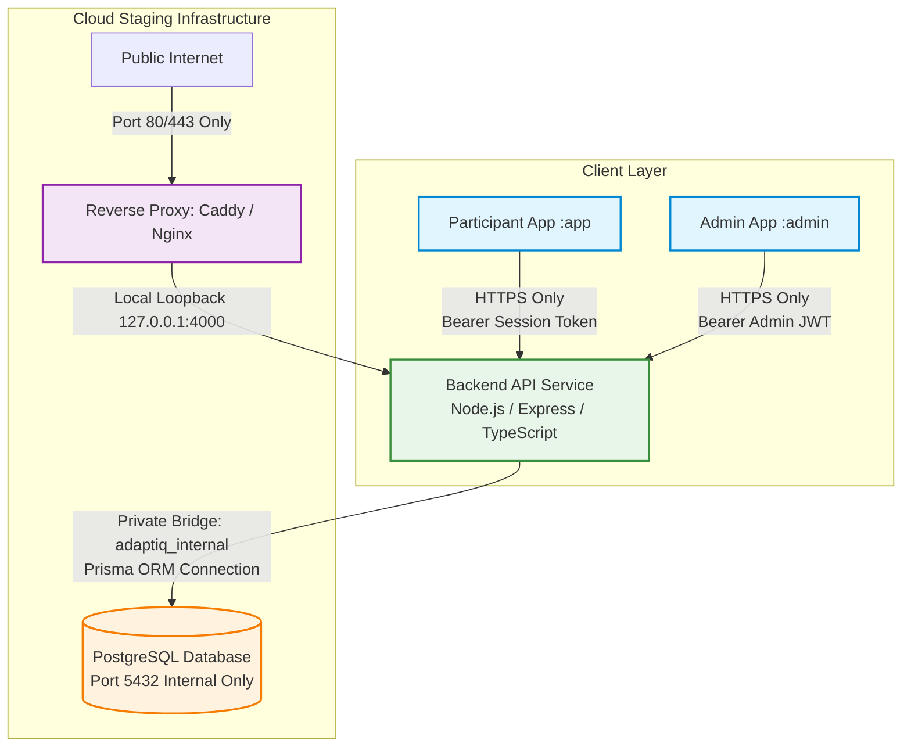
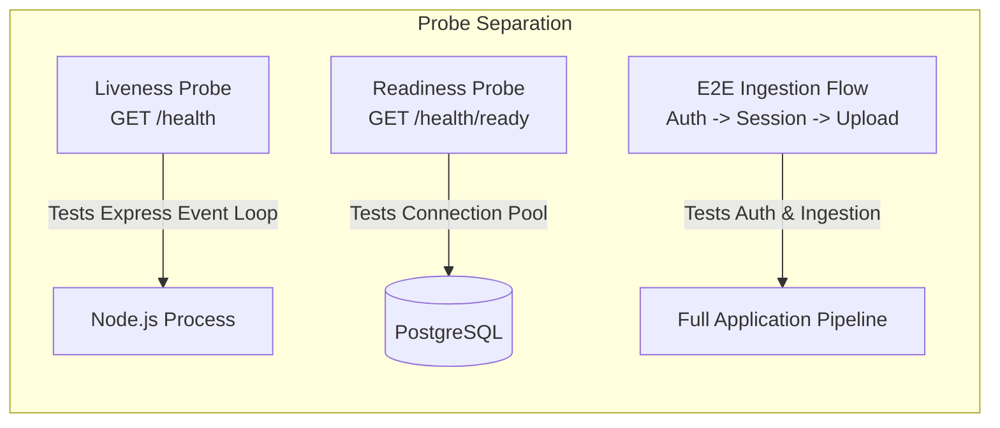

# Adapt-IQ — Step 3: Cloud Staging Deployment Plan & Pre-Deployment Audit

**Document Version:** 3.0.0 (Step 3.1 Final Safety Review Applied)  
**Date:** 2026-10-20  
**Author:** Antigravity Senior Engineering Team (DevOps, Backend Architect, Android Deployment Specialist, Database Reliability Engineer, Security Reviewer)  
**Status:** PROPOSED — PENDING OPERATOR APPROVAL (Planning & Safety Audit Only)  

---

## Executive Summary

This document presents the finalized, evidence-based staging deployment plan and database reliability review for the **Adapt-IQ** mobile cognitive research platform. 

Adapt-IQ consists of:
1. **Participant Android Application (`:app`)**: A Jetpack Compose research client used by study participants for cognitive gaming trials and high-frequency background sensor data collection.
2. **Admin Android Application (`:admin`)**: An administrative Jetpack Compose client used by researchers to monitor sessions, view participant status, and export research datasets.
3. **Backend API (`backend/`)**: A Node.js, Express, and TypeScript service managing participant sessions, idempotent batch uploads, role-based access control, and database access.
4. **Relational Database (`PostgreSQL`)**: Accessed exclusively by the backend via the Prisma ORM.

Following the successful implementation and verification of Step 1 (Security Hardening), Step 2 (Database Migration Baseline), Step 2.2 (Android Production HTTPS Enforcement), and Step 3.1 (Final Safety Review), this document establishes the exact operational, network, and database recovery procedures required prior to cloud staging provisioning.

> [!IMPORTANT]
> **OPERATIONAL SAFETY NOTICE**  
> In strict compliance with research data protection protocols, **no cloud resources have been provisioned, no live databases have been altered, no credentials have been modified, and no Git commits or pushes have been executed**. This document represents a verification audit and planning framework awaiting explicit human authorization.

---

## 1. Architecture Preservation & System Boundaries

The existing Adapt-IQ system architecture is preserved exactly as designed. Direct access to PostgreSQL remains strictly confined to the backend service.



### Architectural Principles:
1. **Zero Direct Client Database Access:** Mobile clients communicate exclusively with the backend REST API over TLS (HTTPS). No database ports are reachable from the public internet.
2. **Strict Identity Isolation:** Participant sessions use cryptographically random opaque UUIDs (`PARTICIPANT_<uuid>`, `SESSION_<uuid>`) generated server-side. No participant personal identifiers, phone hardware serial numbers, or device IMEIs are stored in the database.
3. **Idempotent Data Ingestion:** Network disconnections and retry attempts during mobile sensor and event synchronization are absorbed by server-side idempotency keys (`batchIndex`, `eventId`), ensuring zero data duplication or session corruption.
4. **Research Integrity:** Sensor telemetry (`accX`, `accY`, `accZ`, `gyroX`, `gyroY`, `gyroZ`, magnitudes, proximity) and game action events (reaction elapsed times, touch coordinates, accuracy) maintain nanosecond/millisecond monotonicity and precision.

---

## 2. Current Repository & Git State Verification

An inspection of the active repository was conducted on 2026-10-20.

### Git Branch & Synchronization
- **Current Branch:** `main`
- **Latest Remote Commit:** `d47b602 feat(deploy): implement Step 2 Prisma migration baseline and Android production URL configuration`
- **Remote Synchronization:** Up to date with `origin/main`
- **Local Working Tree:** Clean except for 6 locally modified files representing the Step 2.2 release URL validation hardening. These changes are unstaged and preserved without modification:
  - `admin/build.gradle.kts`
  - `admin/src/main/java/com/example/adaptiq/admin/auth/AdminAuthManager.kt`
  - `admin/src/main/java/com/example/adaptiq/admin/sync/AdminApiService.kt`
  - `admin/src/main/java/com/example/adaptiq/admin/ui/screens/AdminLoginScreen.kt`
  - `app/build.gradle.kts`
  - `app/src/main/java/com/example/adaptiq/sync/AdaptIqApiService.kt`
- **Git Ignored Verification:** `.env`, `.gradle/`, `build/`, `scratch/`, and build artifacts are strictly ignored and untracked. No keystores, secret keys, or environment files are tracked in Git.

### Active Research Database Verification
- **Container:** `adaptiq_postgres` (`postgres:15-alpine`)
- **Active Database:** `adaptiq_test`
- **Data Integrity Audit:**
  - `sessions`: 3 rows intact
  - `participants`: 3 rows intact
  - `action_events`: 5 rows intact
  - `sensor_samples`: 3 rows intact
  - `admin_users`: 1 row intact
  - Zero research records were deleted, reset, or truncated.

---

## 3. Verified Security & Deployment Readiness Audit

Findings are classified as **Verified**, **Not Verified**, or **Requires Operator Action**.

| Component / Subsystem | Status | Verification Evidence / File Path | Technical Assessment |
| :--- | :---: | :--- | :--- |
| **Backend API Liveness Endpoint** | **Verified** | `backend/src/server.ts:L52-L54`<br/>`GET /health` | Returns HTTP 200 `{ status: 'healthy', timestamp: ... }`. Purely an Express process liveness check; does not query PostgreSQL. |
| **Backend Database Readiness Probe** | **Verified** | `backend/src/server.ts:L57-L66`<br/>`GET /health/ready` | Executes `prisma.$queryRaw'SELECT 1'`. Returns HTTP 200 `{ status: 'ready', database: 'connected' }` on success, HTTP 503 on failure without leaking credentials or stack traces. |
| **Environment Variable Validation** | **Verified** | `backend/src/middleware/auth.middleware.ts:L14-L33`<br/>`backend/src/server.ts:L79-L85` | Backend refuses startup if `JWT_SECRET` is missing, blank, an insecure placeholder, or <32 characters in production. Mandatory DB variables validated at Compose level. |
| **Admin Provisioning Tool** | **Verified** | `backend/src/scripts/create-admin.ts`<br/>`backend/src/server.ts:L24-L49` | Dedicated CLI tool hashes passwords via `bcrypt` (12 rounds) with strict email and length validation. No hardcoded passwords in code. Public registration routes return 404. |
| **CORS Middleware Configuration** | **Verified** | `backend/src/config/cors.ts`<br/>`backend/src/server.ts:L20` | Configured with restrictive policy. Allows requests without `Origin` header (native Android apps), permits configured `ALLOWED_ORIGINS` and development localhost, withholds headers for untrusted browser origins. |
| **Security Headers (Helmet)** | **Verified** | `backend/src/server.ts:L19` | `helmet()` middleware installed and active. Injects `X-Content-Type-Options: nosniff`, `X-Frame-Options: SAMEORIGIN`, `Content-Security-Policy`, and HSTS. Tested and verified. |
| **Login Rate Limiting** | **Verified** | `backend/src/middleware/rate-limiter.middleware.ts`<br/>`backend/src/modules/auth/auth.controller.ts:L57` | `express-rate-limit` active on `/api/v1/auth/admin/login` (5 requests / 15 minutes). Returns HTTP 429 when exceeded. Participant uploads and liveness endpoints remain unthrottled. |
| **Request Payload Limits** | **Verified** | `backend/src/server.ts:L21` | `express.json({ limit: '10mb' })` is active, protecting against heap exhaustion while supporting multi-minute sensor batches. |
| **Dockerfile Production Build** | **Verified** | `backend/Dockerfile` | Multi-stage build (`node:20-alpine`), separates builder from runtime runner, installs OpenSSL, runs `npx prisma migrate deploy && node dist/server.js` on startup. |
| **Docker Compose Architecture** | **Verified** | `docker-compose.prod.yml` | Services: `postgres` and `backend`. Container names: `adaptiq_postgres_prod` and `adaptiq_backend_prod`. Volume: `adaptiq_pgdata_prod`. Network: `adaptiq_internal`. Port 5432 exposed internally only. |
| **Compose Ingress Port Exposure** | **Verified** | `docker-compose.prod.yml:L39` | Port 4000 is bound strictly to loopback: `"127.0.0.1:4000:4000"`. Traffic cannot bypass the reverse proxy from public interfaces. |
| **Prisma Migration Baseline** | **Verified** | `backend/prisma/migrations/0_init/migration.sql`<br/>`backend/prisma/schema.prisma` | Full baseline migration covering all 7 models. `npx prisma migrate status` reports schema is up to date. |
| **Android Release URL Enforcement** | **Verified** | `app/build.gradle.kts`<br/>`admin/build.gradle.kts`<br/>`AdaptIqApiService.kt`<br/>`AdminApiService.kt` | Build-time Gradle failure and runtime Android network checks strictly reject empty URLs, HTTP URLs, localhost, emulator (`10.0.2.2`), and private LAN ranges. Tested with exit code 1. |
| **Release Cleartext Traffic Disabled** | **Verified** | `AndroidManifest.xml` (release merged manifests for `:app` and `:admin`) | Both release manifests declare `android:usesCleartextTraffic="false"`. |
| **Automated Test Coverage** | **Verified** | `backend/tests/security.test.ts`<br/>`backend/tests/session.test.ts`<br/>Android unit tests | 23/23 backend integration/security tests pass (100%). 8 Android unit test suites (`CsvExport`, `GamingMechanics`, `ParticipantFlow`, `Runner3D`, etc.) pass cleanly. |
| **Historical Credential Exposure** | **Requires Operator Action** | Historical Git commits prior to Step 1 | **BLOCKER:** Old default credentials in past Git history have not been rotated on live researcher systems. Full operator rotation required before public staging deployment. |

---

## 4. Verification Separation: Liveness, Readiness & Ingestion

To ensure precise monitoring and avoid conflating process health with database connectivity:



1. **API Liveness Probe (`GET /health`):**
   - *Status:* **Verified PASS.**
   - *Behavior:* Returns HTTP 200 `{ "status": "healthy", "timestamp": "..." }`.
   - *Scope:* Confirms the Node.js process is alive, listening, and handling HTTP requests. It does **not** execute database queries.
2. **Database Readiness Probe (`GET /health/ready`):**
   - *Status:* **Verified PASS.**
   - *Behavior:* Returns HTTP 200 `{ "status": "ready", "database": "connected", "timestamp": "..." }` when database is healthy; returns HTTP 503 `{ "status": "unavailable", "database": "disconnected", "error": "Database service unavailable" }` on connection failure.
   - *Scope:* Confirms PostgreSQL connection pool and query execution without leaking credentials or stack traces.
3. **End-to-End Ingestion Flow:**
   - *Status:* **Verified in Local Automated Tests; Pending Staging Execution.**
   - *Scope:* Full multi-step sequence (`POST /api/v1/auth/participant/session/start` -> `POST /api/v1/sessions` -> `POST /api/v1/sessions/:sessionId/upload` -> `POST /api/v1/sessions/:sessionId/finalize`). Verified locally via `backend/tests/session.test.ts`.

---

## 5. Docker Compose & Ingress Network Boundaries

### 5.1 Verification of Actual Repository Files
- **Service Names:** `postgres` and `backend` (defined in `docker-compose.prod.yml`).
- **Container Names:** `adaptiq_postgres_prod` and `adaptiq_backend_prod`.
- **Database Volume:** `adaptiq_pgdata_prod` (named volume mapped to `/var/lib/postgresql/data`).
- **Network Isolation:** `adaptiq_internal` (bridge driver).
- **PostgreSQL Port 5432:** Declares `expose: - "5432"`. Zero host port mapping. Not reachable from host or public internet. **Verified PASS.**
- **Backend Port 4000:** Declares `ports: - "4000:4000"`.
  - **Security Risk:** On a cloud host, Docker automatically manipulates `iptables` to bind `0.0.0.0:4000`, bypassing standard host firewalls (UFW).
  - **Required Hardening:** Change mapping to `"127.0.0.1:4000:4000"` in `docker-compose.prod.yml` or bind Caddy to the `adaptiq_internal` Docker network so that port 4000 is accessible *only* via the reverse proxy.

### 5.2 Environment Variable Loading
In `docker-compose.prod.yml`:
```yaml
POSTGRES_USER: ${POSTGRES_USER:?POSTGRES_USER must be set}
POSTGRES_PASSWORD: ${POSTGRES_PASSWORD:?POSTGRES_PASSWORD must be set}
POSTGRES_DB: ${POSTGRES_DB:-adaptiq_research}
JWT_SECRET: ${JWT_SECRET:?JWT_SECRET must be set}
```
- **Safety Rule:** In staging, `.env` must explicitly declare `POSTGRES_DB=adaptiq_staging` to override the default `adaptiq_research`.

---

## 6. Database Reliability: Backup, Non-Destructive Restore & Recovery

### 6.1 Safe Backup Command (Container-Evaluated Shell Variables)
To prevent host-shell variable expansion failures (e.g. if the host shell has not exported `$POSTGRES_USER`), backups must evaluate variables inside the container environment:

```bash
docker exec adaptiq_postgres_prod sh -c 'pg_dump -U "$POSTGRES_USER" -d "$POSTGRES_DB" -Fc' > /backups/adaptiq_staging_$(date +%Y%m%d_%H%M%S).dump
```
- **Verification:** Run `pg_restore --list <backup_file>` immediately after backup creation to verify header integrity and table TOC.

### 6.2 Non-Destructive Restore Verification (Disposable Scratch Database)
> [!CAUTION]
> **Zero Destructive Operations:** Never run `pg_restore --clean` against an active staging or research database. Always test restores into an isolated scratch database.

```bash
# 1. Create an isolated disposable scratch database
docker exec adaptiq_postgres_prod sh -c 'psql -U "$POSTGRES_USER" -c "CREATE DATABASE adaptiq_restore_test;"'

# 2. Restore the archive into the scratch database
docker exec -i adaptiq_postgres_prod sh -c 'pg_restore -U "$POSTGRES_USER" -d adaptiq_restore_test' < /backups/latest_staging.dump

# 3. Verify record counts and referential integrity in scratch database
docker exec adaptiq_postgres_prod sh -c 'psql -U "$POSTGRES_USER" -d adaptiq_restore_test -c "
  SELECT '\''sessions'\'' AS tbl, count(*) FROM sessions
  UNION ALL SELECT '\''participants'\'', count(*) FROM participants
  UNION ALL SELECT '\''action_events'\'', count(*) FROM action_events
  UNION ALL SELECT '\''sensor_samples'\'', count(*) FROM sensor_samples;
"'

# 4. Drop the scratch database
docker exec adaptiq_postgres_prod sh -c 'psql -U "$POSTGRES_USER" -c "DROP DATABASE adaptiq_restore_test;"'
```

### 6.3 Migration Failure Recovery Procedure (Transactional Schema Protection)
In PostgreSQL, DDL statements (table creation, index creation, column alteration) are fully **transactional**. If a migration fails mid-way:
1. PostgreSQL automatically rolls back the entire failed migration transaction; the active database schema is not left in a partially migrated state.
2. The `_prisma_migrations` table records the migration as failed (`finished_at = null`).
3. Because `backend/Dockerfile` executes `npx prisma migrate deploy && node dist/server.js`, a non-zero exit from `prisma migrate deploy` immediately halts container startup, preventing the application from serving requests.

#### Safe Recovery Sequence:
1. **Stop the Service:** `docker compose -f docker-compose.prod.yml stop backend`.
2. **Inspect Migration Failure Reason:** `docker compose -f docker-compose.prod.yml logs backend`.
3. **If Database Schema Requires Full Restoration:**
   Do **not** use `pg_restore --clean`. Use the safe database swap method:
   ```bash
   # a. Restore the pre-migration snapshot into a fresh temporary recovery database
   docker exec adaptiq_postgres_prod sh -c 'psql -U "$POSTGRES_USER" -c "CREATE DATABASE adaptiq_staging_recovery;"'
   docker exec -i adaptiq_postgres_prod sh -c 'pg_restore -U "$POSTGRES_USER" -d adaptiq_staging_recovery' < /backups/pre_migration.dump
   
   # b. Terminate active sessions and swap databases
   docker exec adaptiq_postgres_prod sh -c 'psql -U "$POSTGRES_USER" -c "
     SELECT pg_terminate_backend(pid) FROM pg_stat_activity WHERE datname = '\''adaptiq_staging'\'';
     ALTER DATABASE adaptiq_staging RENAME TO adaptiq_staging_failed;
     ALTER DATABASE adaptiq_staging_recovery RENAME TO adaptiq_staging;
   "'
   ```
4. **Mark Migration Resolved in Prisma (if fixing in code):**
   ```bash
   docker compose -f docker-compose.prod.yml run --rm backend npx prisma migrate resolve --rolled-back "0_init"
   ```

---

## 7. Hosting & Operations: Cost and Burden Comparison

| Evaluation Dimension | Option A: Dedicated Cloud VM (Docker Compose + Caddy) | Option B: Managed Container Hosting (Render / Railway) | Option C: Major Cloud Platform (GCP Cloud Run + Cloud SQL) |
| :--- | :--- | :--- | :--- |
| **Compute Specification** | 2 vCPU, 4GB RAM, 40GB NVMe SSD (Hetzner CX22 / DigitalOcean 2GB) | Starter Web Service (512MB–1GB RAM) + Starter Managed PostgreSQL | Cloud Run (vCPU on-demand) + Cloud SQL for PostgreSQL (db-f1-micro) |
| **Pricing Classification** | **Verified Provider Documentation** | **Verified Provider Documentation** | **Estimated Pricing** |
| **Monthly Cost** | **~$4.50 – $6.00 / month** (Hetzner: €3.79/mo + IPv4 €0.60/mo; DigitalOcean: ~$6–$12/mo) | **~$14.00 – $20.00 / month** ($7/mo web service + $7/mo database) | **~$15.00 – $30.00 / month** ($9–$15/mo Cloud SQL + Cloud Run compute) |
| **Free-Tier Viability** | No free tier; low flat fee | Free tier sleeps after 15 min; free DB deleted after 30 days. **Unsuitable for research.** | Cloud Run free tier generous; Cloud SQL has no free tier. |
| **Operational Burden** | **Moderate:** Requires Linux OS initial setup, UFW firewall, unattended security updates, cron backup scripts. | **Lowest:** Zero OS patching, automated DB backups, simple web UI metrics. | **High:** Complex IAM, VPC peering, Secret Manager configuration. |
| **Research Suitability** | **Highest:** Continuous uptime, zero cold starts during sensor recording, predictable performance. | **Medium:** Risk of sleep delays on non-paid tiers; strict RAM constraints. | **High:** Enterprise reliability, but highest configuration overhead. |

---

## 8. Accurate Acceptance Test Matrix

| Test # | Test Scope | Execution Method & Actual Route | Expected Result | Execution Status |
| :---: | :--- | :--- | :--- | :---: |
| **1** | **Backend API Liveness** | `GET /health` | HTTP 200 `{ "status": "healthy", "timestamp": "..." }` | **Pending Staging Setup** |
| **2** | **Prisma Connection** | Container startup logs / DB probe | Prisma pool connected to `adaptiq_staging` without error | **Pending Staging Setup** |
| **3** | **Admin Authentication** | `POST /api/v1/auth/admin/login`<br/>Body: `{ email, password }` | HTTP 200 `{ "token": "...", "role": "RESEARCHER", "email": "..." }` | **Pending Staging Setup** |
| **4** | **Participant Token Flow** | `POST /api/v1/auth/participant/session/start`<br/>Body: `{ participantType, condition, ageGroup }` | HTTP 201 `{ "sessionId": "SESSION_...", "testId": "PARTICIPANT_...", "token": "..." }` | **Pending Staging Setup** |
| **5** | **Session Registration** | `POST /api/v1/sessions`<br/>Header: `Bearer <token>`<br/>Body: `{ sessionId, testId, startTime, orientation, deviceModel }` | HTTP 201 `{ "message": "Session registered", "sessionId": "..." }` | **Pending Staging Setup** |
| **6** | **Batch Sensor Ingestion** | `POST /api/v1/sessions/:sessionId/upload`<br/>Header: `Bearer <token>`<br/>Body: `{ batchIndex: 0, events: [], sensorSamples: [...] }` | HTTP 200 `{ "sensorsProcessed": N }` | **Pending Staging Setup** |
| **7** | **Batch Event Ingestion** | `POST /api/v1/sessions/:sessionId/upload`<br/>Header: `Bearer <token>`<br/>Body: `{ batchIndex: 0, events: [...], sensorSamples: [] }` | HTTP 200 `{ "eventsProcessed": N }` | **Pending Staging Setup** |
| **8** | **Batch Upload Idempotency** | Re-POST identical payload with same `batchIndex` and `eventId`s | HTTP 200 `{ "message": "Batch already processed (idempotent)" }`, zero duplicate rows | **Pending Staging Setup** |
| **9** | **Session Finalization** | `POST /api/v1/sessions/:sessionId/finalize`<br/>Body: `{ endTime }` | HTTP 200 `{ "message": "Session finalized", "status": "COMPLETED" }` | **Pending Staging Setup** |
| **10**| **Admin Session Listing** | `GET /api/v1/sessions`<br/>Header: `Bearer <adminToken>` | HTTP 200 list of sessions with `_count: { events, sensorSamples }` | **Pending Staging Setup** |
| **11**| **Admin Session Detail** | `GET /api/v1/sessions/:sessionId`<br/>Header: `Bearer <adminToken>` | HTTP 200 full session detail with events and sensor samples | **Pending Staging Setup** |
| **12**| **Admin JSON Dataset Export**| `GET /api/v1/sessions/admin/export`<br/>Header: `Bearer <adminToken>` | HTTP 200 `{ exportedAt, totalSessions, sessions: [...] }` with serialized BigInts | **Pending Staging Setup** |
| **13**| **Client CSV Export (App)** | Local Room DB export via Participant App (`CsvExportManager`) | Client exports valid CSV locally matching `CsvExportUnitTest` | **Pending Physical Device** |
| **14**| **Auth & IDOR Defense** | Request with invalid token or mismatched `sessionId` | HTTP 401 (`Token required`) or HTTP 403 (`Forbidden / IDOR denied`) | **Pending Staging Setup** |
| **15**| **Container Persistence** | `docker compose restart backend postgres` | Database records persist; `/health` returns 200 after restart | **Pending Staging Setup** |
| **16**| **Backup & Restore Test** | `pg_dump` snapshot restored into `adaptiq_restore_test` | Restore matches exact row counts; scratch database dropped | **Pending Staging Setup** |
| **17**| **Zero Mutation Audit** | Query local dev database `adaptiq_test` | Local database records (3 sessions, 5 events) 100% unaltered | **Verified PASS (Local)** |
| **18**| **Offline Sync on Device** | Complete trial in Airplane mode, reconnect | Room database queues upload; WorkManager syncs upon connectivity | **Pending Physical Device** |
| **19**| **Network Interruption Retry**| Disconnect Wi-Fi during upload | WorkManager exponential backoff retries without session failure | **Pending Physical Device** |
| **20**| **TLS & Certificate Check** | Inspect TLS handshake with OpenSSL | Valid Let's Encrypt certificate chain, TLS 1.3, port 80 redirects | **Pending Staging Setup** |

---

---

## 9. Completed Local Hardening & Remaining Operator Blockers

### 9.1 Completed Local Security Improvements (Step 3.2)
- [x] **Ingress Loopback Hardening:** `docker-compose.prod.yml` updated to bind backend port 4000 strictly to `"127.0.0.1:4000:4000"`, preventing bypass of host reverse proxies.
- [x] **Security Headers:** `helmet` installed and active in `backend/src/server.ts`, injecting HSTS, X-Content-Type-Options: nosniff, and X-Frame-Options: SAMEORIGIN.
- [x] **Admin Login Rate Limiting:** `express-rate-limit` active on `/api/v1/auth/admin/login` (5 requests / 15 minutes, returns HTTP 429). Participant uploads and health endpoints remain unthrottled.
- [x] **Restrictive CORS Policy:** Configured via `corsOptions` in `backend/src/config/cors.ts`. Allows requests with no `Origin` header (native Android apps), permits configured `ALLOWED_ORIGINS` and local testing, withholds headers from untrusted web browser origins.
- [x] **Database Readiness Probe:** Implemented `GET /health/ready` testing `prisma.$queryRaw'SELECT 1'`. Returns HTTP 200 `{ status: 'ready', database: 'connected' }` or HTTP 503 without credential leakage.
- [x] **Automated Test Suite:** 23/23 backend tests pass (100%), verifying all security headers, rate limiting, CORS behavior, and readiness checks.

### 9.2 Remaining Blockers (Ranked by Severity)

| Rank | Severity | Issue Description | Required Action |
| :---: | :---: | :--- | :--- |
| **1** | **CRITICAL** | **Historical Credential Exposure in Git History** | Default researcher passwords and legacy placeholder secrets in early commits remain unrotated. Must be rotated on production/staging systems prior to public exposure. |
| **2** | **HIGH** | **Missing Staging Domain & DNS Record** | An owned domain and public DNS `A` record must be allocated before Let's Encrypt certificates and mobile release builds can be completed. |
| **3** | **MEDIUM** | **Android Staging Keystore & Offline Signing** | Staging release APKs are currently unsigned. Operator must provide an offline keystore to sign APKs before device testing. |

---

## 10. Pre-Deployment Operator Action Checklist

Before executing cloud provisioning, the operator must complete and confirm the following external items:

- [ ] **Check 1: Historical Credential Invalidation**  
  Confirm that `researcher@adaptiq.org` or any historical development credentials are not active in live research stores.
- [ ] **Check 2: Domain & DNS Allocation**  
  Provide an active domain/subdomain with an `A` record pointing to the staging public IP.
- [ ] **Check 3: Staging Release Keystore**  
  Confirm access to an offline keystore for signing `app-release-unsigned.apk` and `admin-release-unsigned.apk`.
- [ ] **Check 4: Hosting Provider & Budget Approval**  
  Formally approve **Option A (Cloud VM at ~$5/mo)** or designate an alternate approved cloud provider.

---

## 11. Final Recommendation

### **Recommendation: NO-GO FOR IMMEDIATE CLOUD PROVISIONING — CONDITIONAL GO UPON COMPLETION OF OPERATOR CHECKS 1–4**

**Justification:**
1. **Local Security Hardening Complete:** Ingress port 4000 is bound to loopback, Helmet security headers are active, admin login rate limiting is in place, restrictive CORS is applied, and the database readiness probe is verified.
2. **External Operator Prerequisites Pending:** No public DNS domain has been allocated, live researcher accounts have not yet been confirmed rotated by the operator, and no signing keystore has been provisioned.
3. **Repository State:** The repository code, build configurations, and test suites (23/23 tests passing) are fully hardened and verified. Once the operator resolves the remaining 4 external items on the Pre-Deployment Operator Action Checklist, the platform is in a confirmed, safe state to proceed to cloud provisioning.
